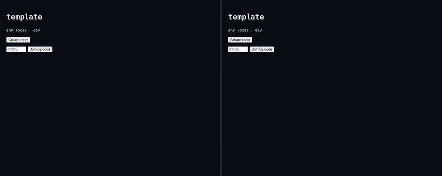

# Hackathon kit

[](https://github.com/muneeebnaveeed/hackathon-kit/generate)




A GitHub template for a multiplayer game hackathon. **Organizers: create a repository from this template, then follow [KIT_SETUP.md](KIT_SETUP.md) before the event.**

The hackathon repository: each team builds a real-time multiplayer browser game in `games/team-N/`, on one shared platform in `server/`.

**New here? Start with [GETTING_STARTED.md](GETTING_STARTED.md).** It takes you from a fresh machine to your first merged pull request.

| Part | Technology | Where |
|------|------------|-------|
| Game frontends | **Vite + TypeScript** | `games/team-N/` |
| Multiplayer server | Colyseus 0.18 on Node.js | `server/` |
| Hosting | Railway | see [server/ARCHITECTURE.md](server/ARCHITECTURE.md) |

## Branches

`team-N/<issue>-…` → `feature/team-N` → `main`. Each team merges its work into its own `feature/team-N` branch, and finished work goes into `main` once CI is green. `main` is what is live: every merge into it deploys to production. The details are in [CLAUDE.md](CLAUDE.md#branches).

## Read next

- [GETTING_STARTED.md](GETTING_STARTED.md): set up your machine, start your team's game, make your first change
- [CLAUDE.md](CLAUDE.md): the rules every agent and person follows, including the branch model (the single source of truth; `AGENTS.md` points to it)
- [course/README.md](course/README.md): how the hackathon runs and how work is evaluated
- [server/CLAUDE.md](server/CLAUDE.md): how a game uses the shared platform

```bash
pnpm install
pnpm dev        # template game at http://localhost:5173
```
